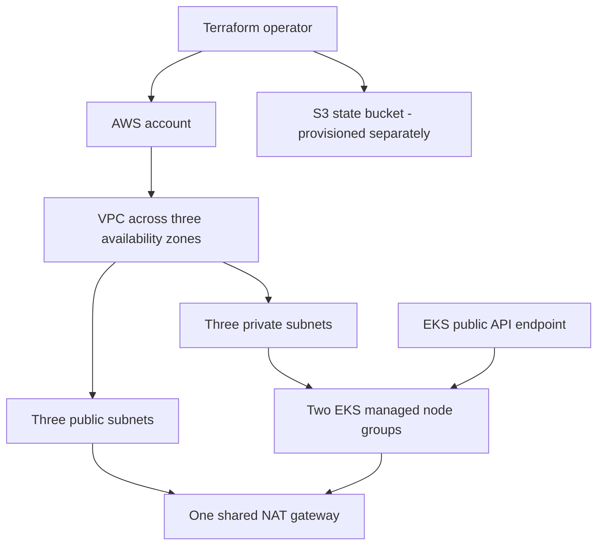

# Infrastructure guide

[Back to README](../README.md) · [Branch and pipeline guide](pipeline.md)

This guide describes the checked-in configuration on `main`.

## Architecture



[`vpc.tf`](../terraform/vpc.tf) selects the first three available zones in the chosen region. Subnets have Kubernetes load balancer discovery tags. [`eks-cluster.tf`](../terraform/eks-cluster.tf) places both node groups in the private subnets. The EKS module is pinned to `19.19.1`; the VPC module is pinned to `5.1.2`.

The single NAT gateway is shared across the three zones. The node groups have desired sizes of two and one. This repository does not define application Deployments, an ingress controller, Argo CD, a container registry, or a database workload. Those must be supplied separately; the companion [application repository](https://github.com/MichaelGarrido/vprofile-action) includes example workload manifests.

## Inputs, providers, and outputs

| Setting | Source | Meaning |
| --- | --- | --- |
| `region` | [`variables.tf`](../terraform/variables.tf) | AWS provider region; defaults to `us-east-2` |
| `clusterName` | [`variables.tf`](../terraform/variables.tf) | EKS cluster name; review before using an existing account |
| S3 backend | [`terraform.tf`](../terraform/terraform.tf) | Existing bucket, state key, and bucket region; separate from input variables |
| Provider constraints | [`terraform.tf`](../terraform/terraform.tf) | AWS `~> 5.25.0`, Kubernetes `~> 2.23.0`, plus random, TLS, and cloud-init |
| Outputs | [`outputs.tf`](../terraform/outputs.tf) | Cluster name, endpoint, region, and cluster security group ID |

The Kubernetes provider in [`main.tf`](../terraform/main.tf) receives the endpoint and CA certificate but has no explicit authentication configuration. There are no standalone Kubernetes resources in this root configuration. Add an appropriate authentication method before extending it to manage workloads.

## Prepare and review a plan

1. Use the Terraform version constraint from the branch you checked out. `main` and `stage` currently differ; see the [pipeline guide](pipeline.md).
2. Select the intended AWS account and provide credentials through your local AWS configuration or the execution environment. Do not place credentials in tracked files.
3. Prepare an S3 state bucket and access permissions outside this configuration. Choose a state key that will not overlap another environment. The literal backend settings in the source are examples tied to the original setup.
4. Review the region, CIDR ranges, cluster name, Kubernetes version, node image type, and instance capacity against your target environment.
5. Initialize the backend with your own values and inspect the plan before applying:

```sh
cd terraform
terraform init \
  -backend-config="bucket=YOUR_STATE_BUCKET" \
  -backend-config="key=YOUR_ENVIRONMENT/terraform.tfstate" \
  -backend-config="region=YOUR_STATE_BUCKET_REGION"
terraform fmt -check
terraform validate
terraform plan \
  -var="region=YOUR_AWS_REGION" \
  -var="clusterName=YOUR_CLUSTER_NAME" \
  -out=planfile
terraform show planfile
```

Replace the placeholders first. The backend region refers to the state bucket and is independent of the AWS provider's `region` variable. If Terraform reports an existing backend configuration, inspect its state location before choosing whether to reconfigure or migrate it.

Applying a reviewed plan is a separate infrastructure operation:

```sh
terraform apply planfile
```

Plan files and state can contain sensitive infrastructure data; keep them out of version control. The ignore rules do not remove files already tracked by Git. Retain and review `.terraform.lock.hcl` when establishing reproducible provider selections.

## Current limitations and follow-up work

- EKS `1.27`, the AL2 node image, module versions, and provider constraints are fixed in source. Review their suitability and availability before attempting a new deployment.
- Public cluster endpoint access is enabled. The root configuration does not set an explicit allowed CIDR list or enable private endpoint access.
- A single NAT gateway supplies outbound access for all private subnets. This is a cost-oriented lab topology with a shared egress dependency.
- The S3 bucket is not created here. The backend block contains no explicit state-locking configuration, and the repository does not manage bucket versioning or access policies.
- No environment-specific state layout, workload storage, monitoring configuration, ingress controller, or application deployment is defined in this repository.
- The repository contains no automated infrastructure tests.

Before removing an environment, review `terraform plan -destroy` with the correct backend and account selected. Workload-created resources and data require their own cleanup and backup decisions; destroying this configuration is not a complete application teardown procedure.
